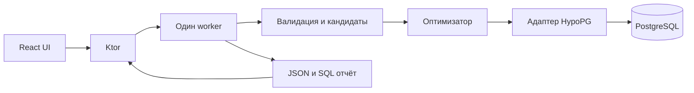

# IndexBudget спецификация MVP для хакатона

Версия 0.1. Статус: черновик для ревью.

IndexBudget подбирает набор дополнительных индексов PostgreSQL под заданную нагрузку и ограничения на место и сопровождение записи. Разработчик загружает SQL с частотами, задаёт бюджеты и получает лучший найденный набор, оценку изменения стоимости запросов и SQL для создания индексов.

К концу хакатона должен работать сквозной сценарий на воспроизводимой демонстрационной БД. Главная ценность — выбор комбинации под ограничениями: индекс, полезный сам по себе, может оказаться лишним рядом с другим или слишком дорогим для активно изменяемой таблицы.

## 1 Пользовательский сценарий

Основной пользователь — разработчик или инженер БД, который понимает свои запросы, но не хочет вручную перебирать сочетания индексов.

1. Поднимает проект через Docker Compose. Backend подключается к PostgreSQL по переменной окружения.
2. Загружает JSON с SQL и частотами выполнения либо выбирает готовый пример.
3. Задаёт бюджет дополнительного места и бюджет условной нагрузки на запись.
4. Запускает анализ и видит стадию работы.
5. Получает набор индексов, расход бюджетов, общий эффект и сравнение по каждому запросу.
6. Скачивает отчёт JSON и SQL. Применение SQL остаётся отдельным действием пользователя.

Пример вопроса, на который отвечает продукт: «У меня есть 64 MiB на новые индексы. Какие из них выгоднее для этого набора запросов, если таблица активно обновляется?»

## 2 Обязательный объём и дополнительные возможности

| Обязательно за пять дней | Дополнительно после сквозного MVP |
| --- | --- |
| PostgreSQL 16 и HypoPG в Docker Compose | Другие версии PostgreSQL и несколько подключений |
| Импорт JSON с конкретными SQL и частотами | Импорт из pg_stat_statements и generic plans |
| Чтение схемы, существующих индексов и статистики | Автоматический сбор профиля записи |
| Простые SELECT и B-tree индексы на одной или двух колонках | Partial, expression, INCLUDE, GIN и GiST индексы |
| Оценка комбинаций через HypoPG | Поиск пар, локальные обмены и более широкий поиск |
| Ограничение оценочного размера и модели записи | Калибровка модели по реальным write benchmarks |
| Один экран результатов, JSON и SQL на скачивание | История, аккаунты, сложная визуализация планов |
| Проверка рекомендаций на тестовой БД | Автоматическое применение и удаление индексов |

Существующие реальные индексы сохраняются и участвуют в baseline. Оба бюджета относятся только к добавляемым индексам. RAM, CPU, время построения индексов и лимит реального замедления записи в MVP не оптимизируются.

## 3 Входные данные

### Workload и настройки

Версия формата — `schema_version: 1`. Частоты запросов и изменяемых строк задаются в пересчёте на час. Это профиль предполагаемой нагрузки: ждать час для запуска анализа не требуется.

```json
{
  "schema_version": 1,
  "queries": [
    {
      "id": "records_by_group",
      "sql": "SELECT id, value FROM public.records WHERE group_id = 42 ORDER BY created_at DESC LIMIT 20",
      "calls_per_hour": 3000
    }
  ],
  "table_write_rates": {
    "public.records": {
      "inserts_per_hour": 1000,
      "updates_per_hour": 3000,
      "deletes_per_hour": 100,
      "source": "manual"
    }
  },
  "constraints": {
    "storage_budget_bytes": 67108864,
    "write_budget_units_per_hour": 10000,
    "max_indexes": 5
  }
}
```

Workload содержит от 1 до 20 запросов. `id` уникален, `calls_per_hour` — положительное конечное число, write rates — неотрицательные конечные числа. `storage_budget_bytes` — целое число от нуля, `write_budget_units_per_hour` — конечное число от нуля либо `null`. Размер передаётся в байтах; UI показывает MiB. `max_indexes` лежит в диапазоне от 0 до 5. Нулевой бюджет места или `max_indexes: 0` дают только baseline и пустой набор.

При включённом бюджете записи нужны значения для всех таблиц поддержанного workload. Неизвестная частота не равна нулю: отсутствие данных даёт ошибку валидации. Явный `write_budget_units_per_hour: null` отключает это ограничение; UI обозначает такой запуск как анализ без бюджета записи. В этом режиме rates можно не передавать: неизвестные write units и их сумма возвращаются как `null` с подписью «нет данных». При полном профиле сумма рассчитывается и без ограничения.

Для MVP SQL содержит конкретные значения. `pg_stat_statements` нормализует запросы и не сохраняет исходные значения параметров. PostgreSQL 16 позволяет строить generic plans с `$1`, но такой режим требует отдельной обработки и не отражает избирательность конкретных значений. [pg_stat_statements](https://www.postgresql.org/docs/16/pgstatstatements.html), [EXPLAIN](https://www.postgresql.org/docs/16/sql-explain.html).

### Поддержанный SQL

Поддерживается один SELECT на запись workload, обычные таблицы, алиасы, до трёх таблиц, INNER JOIN с равенством колонок, WHERE с AND и сравнениями `=`, `<`, `<=`, `>`, `>=`, ORDER BY по одной или двум колонкам с ASC или DESC, числовой LIMIT. В SELECT допускаются колонки и `*`; литералы могут иметь явное приведение к типу, например timestamp.

CTE, подзапросы, OR, GROUP BY, оконные выражения, вызовы функций, views, partitioned tables, пользовательские типы и операторы, параметры `$1`, DML и несколько statements отклоняются с указанием query ID и причины. Пользователь правит workload; неподдержанные запросы не исчезают из расчёта молча.

SQL разбирается в AST через JSqlParser; поддерживается ограниченный набор PostgreSQL SELECT, описанный выше. Колонки разрешаются через каталог БД, включая алиасы и неоднозначные имена. Поиск колонок регулярными выражениями не используется. [JSqlParser](https://github.com/JSQLParser/JSqlParser).

### Снимок БД

Адаптер читает обычные таблицы, колонки и типы, оценку числа строк, существующие индексы и доступность статистики планировщика. Demo seed выполняет ANALYZE до работы приложения. Backend не запускает ANALYZE на целевой БД автоматически. Отсутствие статистики выводится как предупреждение о качестве оценки.

## 4 Метрики и ограничения

### Польза для чтения

Обозначим через `S` набор новых индексов, через `f(q)` частоту запроса, через `cost(q, S)` значение `Plan.Total Cost` корневого узла EXPLAIN. Реальные существующие индексы доступны при любой оценке.

```text
C(S) = sum(f(q) * cost(q, S))
gain(S) = C(empty) - C(S)
gain_percent(S) = 100 * gain(S) / C(empty)
```

Цель — минимизировать `C(S)` при соблюдении обоих бюджетов. При нулевом baseline процент показывается как `null`, абсолютное изменение сохраняется.

В интерфейсе метрика называется «снижение взвешенной стоимости планов». Cost измеряется в условных единицах PostgreSQL; корневое значение уже включает дочерние узлы. Процент изменения cost не переводится в процент ускорения или миллисекунды. [Using EXPLAIN](https://www.postgresql.org/docs/16/using-explain.html).

Для каждого запроса показываются baseline cost, cost с выбранным набором, изменение и частота. Отдельный запрос может ухудшиться при улучшении суммы; такие строки выделяются. Ограничения на регрессию каждого запроса в MVP нет.

### Место

```text
estimated_bytes(i) = hypopg_relation_size(i)
budgeted_bytes(i) = ceil(1.2 * estimated_bytes(i))
sum(budgeted_bytes(i) for i in S) <= storage_budget_bytes
```

Коэффициент 1.2 — выбранный запас для MVP, он сохраняется в отчёте. UI показывает исходную оценку и объём с запасом, по которому проверяется бюджет. Это ограничение оценки; фактический размер после построения может отличаться.

### Нагрузка на запись

В MVP используется простая модель, которую можно воспроизвести независимо от оптимизатора:

```text
row_changes(t) = inserts_per_hour(t)
              + updates_per_hour(t)
              + deletes_per_hour(t)
write_units(i) = row_changes(table(i)) * number_of_key_columns(i)
sum(write_units(i) for i in S) <= write_budget_units_per_hour
```

Единица измерения — «условные единицы сопровождения индексов в час». Например, 4100 изменяемых строк в час дают 8200 единиц для индекса на двух колонках. Это эвристика; она не измеряет WAL, I/O или процент замедления INSERT и UPDATE.

Все UPDATE учитываются. Модель не описывает ширину ключа, HOT, bloat и отложенную очистку после DELETE. Если позже брать частоты из `pg_stat_user_tables`, нужны разности счётчиков между двумя наблюдениями и длительность интервала; уменьшившиеся счётчики означают сброс. Текущую долю HOT нельзя автоматически переносить на новые индексы. [Статистика PostgreSQL](https://www.postgresql.org/docs/16/monitoring-stats.html), [HOT](https://www.postgresql.org/docs/16/storage-hot.html).

Модель записи и planner cost остаются отдельными величинами: для MVP не вводится коэффициент, который складывает их в одну сумму.

## 5 Генерация кандидатов

Генератор строит неуникальные B-tree индексы на одной или двух обычных колонках:

1. Одноколоночные варианты для колонок WHERE, JOIN и ORDER BY.
2. Двухколоночные варианты на одной таблице из одного запроса: равенство перед диапазоном; равенство перед колонкой сортировки; две колонки равенства в обоих порядках; пара колонок ORDER BY в исходном порядке и направлениях.
3. Удаление повторов и точных структурных совпадений с доступными валидными реальными индексами. Для сравнения берутся только обычные B-tree без predicate, expressions и INCLUDE; должны совпасть ключи, порядок, направления, NULLS, collation и opclass с генерируемым определением. Partial index `(a) WHERE ...` не заменяет общий `(a)`. Индекс `(a, b)` не считается достаточным основанием удалить кандидата `(a)`.
4. Детерминированное сокращение до 16 кандидатов: сначала по сумме частот запросов, породивших кандидат, затем по числу колонок и стабильному ID. При сокращении отчёт содержит исходное число и предупреждение.

Порядок ключей существенен для B-tree, а направление сортировки может влиять на поддержку ORDER BY. Эти правила задают варианты; пользу каждого проверяет PostgreSQL. [Multicolumn indexes](https://www.postgresql.org/docs/16/indexes-multicolumn.html), [Indexes and ORDER BY](https://www.postgresql.org/docs/16/indexes-ordering.html).

ID кандидата определяется канонической структурой `schema, table, method, ordered keys, directions`. Имя `ib_<hash>` стабильно, идентификаторы в SQL экранируются средствами драйвера. Для каждого кандидата сохраняются породившие его query IDs, DDL, оценка размера, write units и результат рассмотрения.

Причины отказа: точный дубль, превышение бюджета, ошибка создания гипотезы, отсутствие положительной предельной пользы. Состояния «не выбран эвристикой», «не проверен из-за лимита» и «отсечён лимитом кандидатов» различаются. Глобальная бесполезность индекса на основании одного запуска не утверждается.

## 6 Оценка наборов через HypoPG

Один запуск владеет одним выделенным PostgreSQL connection. HypoPG хранит гипотетические индексы в конкретной backend session и использует их только для EXPLAIN без ANALYZE. Оценка размера доступна через `hypopg_relation_size`. [HypoPG usage](https://hypopg.readthedocs.io/en/rel1_stable/usage.html).

Контракт `evaluate(S)`:

1. Очистить предыдущие гипотетические индексы через `hypopg_reset()`.
2. Создать ровно индексы набора S через `hypopg_create_index()`.
3. Для каждого запроса выполнить `EXPLAIN (FORMAT JSON)` и прочитать корневой Total Cost.
4. Вернуть оценку только после успеха всех запросов workload.
5. В `finally` очистить гипотезы; после сбоя транзакции сначала выполнить rollback. Закрытие соединения завершает сессию.

Базовая оценка использует пустой набор гипотез. Все оценки одного запуска используют одну БД, один профиль и одинаковые настройки планировщика. Не включаем `enable_seqscan=off` ради получения красивого эффекта. Кэш оценок работает только внутри запуска, по отсортированным candidate IDs.

Нельзя сложить отдельные выигрыши двух индексов и считать это выигрышем набора: PostgreSQL может выбирать один из них или комбинировать их. Поэтому любое рассматриваемое сочетание переоценивается целиком. [Combining indexes](https://www.postgresql.org/docs/16/indexes-bitmap-scans.html).

Extension устанавливается при подготовке контейнера. Runtime role получает доступ на чтение demo schema и необходимые функции HypoPG. Приложение работает локально с доверенной demo DB; произвольный пользовательский SQL и произвольные внешние подключения как публичный сервис находятся вне MVP.

## 7 Алгоритм выбора

MVP использует жадный поиск с переоценкой предельной пользы и сохранением лучшего полностью проверенного допустимого набора. Он не гарантирует глобальный оптимум.

1. Полностью оценить baseline `S = empty`.
2. Получить размеры кандидатов и write units. Отсеять варианты, которые уже по отдельности нарушают бюджет.
3. Для каждого допустимого добавления `i` оценить весь набор `S + i` и посчитать `delta = C(S) - C(S + i)`.
4. Из вариантов с положительным delta выбрать максимальный score:

```text
storage_share = budgeted_bytes(i) / storage_budget_bytes
write_share = write_units(i) / write_budget_units_per_hour
score = delta / max(storage_share, write_share, 1e-9)
```

Отключённое ограничение и ограничение с нулевым бюджетом не участвуют в знаменателе. Допустимость проверяется до score: при нулевом write budget проходят только кандидаты с нулевыми write units. Порог положительного delta — `1e-9 * max(C(empty), 1)`. При равном score выбирается меньший стабильный candidate ID.

5. Добавить выбранный индекс и повторять, пока есть положительное допустимое добавление и свободные слоты.
6. Вернуть лучший набор из всех полностью оценённых допустимых конфигураций, включая пустой набор и одиночные индексы. При равном эффекте предпочесть меньший расход места, затем write units, затем лексикографический список IDs. Критерий write units используется только при полном профиле записи; иначе пропускается для всех наборов.

Выгоды индексов пересчитываются после каждого выбора. Пара индексов, у которой нет одиночной пользы, может быть пропущена. Проверка пар и обменов — первая алгоритмическая дополнительная возможность после MVP.

### Лимиты и остановка

Ограничения MVP: до 20 запросов, до 16 оцениваемых кандидатов, до 5 выбранных индексов. До 2000 вызовов EXPLAIN и 60 секунд на поиск вместе с baseline, также в пределах общего deadline. Один EXPLAIN ограничен меньшим из двух секунд и оставшегося времени. Общий deadline задания — 90 секунд с начала работы worker, включая подготовку. Он передаётся всем операциям адаптера, включая introspection, создание гипотез и оценку размера; SQL ограничивается statement_timeout по оставшемуся времени, подключение — таймаутом до пяти секунд. Deadline проверяется также между этапами CPU-работы. Перед освобождением worker незавершённый SQL отменяется, соединение очищается или закрывается. Это предел работы анализатора, без обещания точного времени доставки HTTP-ответа при сбое сети.

Без дополнительных этапов пять жадных раундов на максимальном входе требуют не более `20 * (1 + 16 + 15 + 14 + 13 + 12) = 1420` EXPLAIN. Это верхняя оценка числа вызовов, не обещание времени выполнения.

Если времени или числа вызовов не хватает, возвращается лучший уже полностью оценённый набор со статусом `partial` и причиной. Недооценённая конфигурация отбрасывается. Если baseline не завершён, запуск получает `failed`: сравнимого результата нет. Лимит кандидатов всегда виден в отчёте, даже если сам жадный поиск завершён.

Ошибка создания конкретного кандидата исключает его с причиной. Ошибка EXPLAIN делает оценку всего рассматриваемого набора недействительной; её нельзя подменять нулевым cost или суммой по оставшимся запросам. Потеря соединения и истечение общего deadline завершают поиск: после полного baseline возвращается `partial`, до него — `failed`. Они не маскируются под ошибку одного кандидата. Отдельная недействительная конфигурация отражается в warnings и не считается успешно проверенной.

## 8 Архитектура и стек

Стек backend: Kotlin/JVM на JDK 21, Ktor, kotlinx.serialization и PostgreSQL JDBC. Сборка — Gradle Kotlin DSL. Frontend: React, TypeScript и Vite. БД: PostgreSQL 16 с HypoPG. Окружение поднимается через Docker Compose. [Ktor](https://ktor.io/docs/server-serialization.html), [PostgreSQL JDBC](https://jdbc.postgresql.org/documentation/use/).



Для MVP backend выполняет один анализ одновременно. Повторный запуск при занятом обработчике возвращает `409 ANALYSIS_BUSY`. JDBC-операции выполняются в фоне и не блокируют обработку HTTP; одно соединение закрепляется за всем запуском анализа, чтобы сохранять состояние HypoPG.

### API

| Метод и путь | Результат |
| --- | --- |
| GET /api/health | Доступность backend, PostgreSQL, версия и наличие HypoPG |
| GET /api/demo/workloads | Готовые демонстрационные запросы с профилями и бюджетами |
| POST /api/analyses | JSON с workload, профилем записи и бюджетами; ответ 202 с analysis_id |
| GET /api/analyses/{id} | Статус, стадия, счётчики; при завершении — выбранные индексы, эффект и расход бюджетов |
| GET /api/analyses/{id}/report.json | Полный машиночитаемый отчёт |
| GET /api/analyses/{id}/indexes.sql | Детерминированный SQL выбранного набора |

Статусы: `queued`, `running`, `completed`, `partial`, `failed`. Стадии: validation, introspection, candidates, baseline, search, report. UI опрашивает статус раз в секунду и показывает стадию с числом проверенных наборов, без выдуманного процента прогресса.

Неверный формат даёт 422 с query ID или полем. Ошибки, обнаруженные worker при разрешении SQL через каталог, попадают в `failed` с теми же деталями. Единый формат ошибки: `code`, `message`, `query_id`, `details`; неизвестное задание — 404.

Отчёт включает версию формата, hash входа, параметры и версии окружения, время и длительность запуска, бюджеты, профиль записи, обе оценки объёма, per-query costs, планы baseline и финального набора, warnings и статистику поиска. Hash считается как SHA-256 от UTF-8 JSON с рекурсивной сортировкой ключей, без пробелов между элементами, с сохранением строк SQL и порядка массивов. Полные планы промежуточных конфигураций в итоговый отчёт не попадают. DSN и пароли не возвращаются в API, отчётах и логах.

SQL экспортируется с полностью квалифицированными таблицами, стабильными именами и без автоматического выполнения.

## 9 Интерфейс

Один экран с четырьмя блоками:

1. Выбор примера или загрузка JSON; список запросов и частот.
2. Бюджет места, бюджет записи и профиль изменяемых строк по таблицам.
3. Кнопка запуска, стадия и понятная ошибка при проблеме.
4. Результат: общий эффект, расход двух бюджетов, таблица выбранных индексов, сравнение запросов, причины отказов, скачивание SQL и JSON.

Результат подписывается «лучший найденный набор среди проверенных конфигураций». Оценка planner cost, оценочный объём и условные единицы записи имеют разные подписи. Реальные измерения показываются отдельно от оценок планировщика.

При `partial` показывается результат и причина остановки. При пустом наборе объясняется, что baseline оказался лучшим из проверенных допустимых вариантов либо бюджет исключил добавления. При изменении входных данных старый результат остаётся привязан к прежним параметрам и обозначается как требующий нового запуска.

## 10 Демо и измерения

Для демонстрации достаточно подготовленной БД и нескольких SQL-запросов с разными частотами. Показываем, как меняется набор рекомендованных индексов при разных бюджетах места и записи.

Оценки HypoPG показываются отдельно от фактического эффекта, который проверяется на тестовой БД.

## 11 Задачи проекта

### MVP

- [ ] Создать backend на Kotlin/Ktor и frontend на React.
- [ ] Настроить Docker Compose с PostgreSQL 16, HypoPG и приложением.
- [ ] Реализовать подключение к БД и чтение схемы, существующих индексов и статистики.
- [ ] Добавить загрузку и валидацию JSON с SQL, частотами, профилем записи и бюджетами.
- [ ] Реализовать разбор SQL и определение используемых таблиц и колонок.
- [ ] Генерировать одноколоночные и двухколоночные B-tree индексы, удалять дубли и ограничивать число кандидатов.
- [ ] Реализовать оценку наборов индексов и их размера через HypoPG с очисткой гипотез после анализа.
- [ ] Рассчитывать базовую стоимость workload и эффект от добавления индексов с учётом частот запросов.
- [ ] Реализовать ограничение по месту и модель нагрузки на запись.
- [ ] Реализовать алгоритм выбора комбинации индексов с переоценкой пользы всего набора.
- [ ] Добавить лимиты поиска, обработку ошибок и возврат частичного результата при остановке.
- [ ] Реализовать API проверки подключения, запуска анализа, получения статуса и результата.
- [ ] Формировать отчёт с выбранными индексами, эффектом по запросам, расходом бюджетов и причинами отказа от кандидатов; добавить скачивание SQL и JSON.
- [ ] Сделать интерфейс загрузки workload, настройки бюджетов и профиля записи, запуска анализа и просмотра результатов.
- [ ] Подготовить тестовую БД и примеры workload, соединить компоненты и проверить сквозной сценарий.
- [ ] Описать настройку и запуск проекта в README.

### Дальнейшее развитие

- [ ] Добавить импорт из `pg_stat_statements` и обработку параметризованных запросов.
- [ ] Автоматически собирать профиль записи по таблицам.
- [ ] Расширить поддерживаемый SQL: OR, GROUP BY, CTE и подзапросы.
- [ ] Добавить partial, expression и INCLUDE индексы.
- [ ] Исследовать поддержку других типов индексов, включая GIN и GiST, и подобрать для них способ оценки.
- [ ] Улучшить поиск: проверять пары индексов, обмены и больше конфигураций.
- [ ] Откалибровать модель нагрузки на запись по реальным измерениям.
- [ ] Поддержать другие версии PostgreSQL и несколько подключений.
- [ ] Добавить историю запусков и сравнение рекомендаций.
- [ ] Добавить визуализацию планов запросов.
- [ ] Добавить применение рекомендаций и управление существующими индексами.
